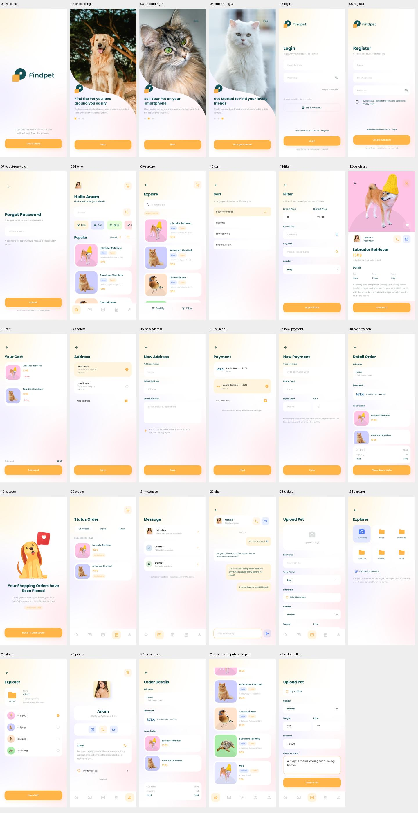

# 界面截图索引

参考来源：Pixso **RAW_Findpet → Wareframe**。设计稿统一为 414 × 896；运行截图由 Android 15 / API 35 模拟器采集，分辨率 1080 × 2400。长表单与列表可以滚动，单张截图展示当时的可见区域。

- `design-reference/`：用户提供的原始设计，仅作参考。
- `screenshots/`：实际 Flutter 控件运行结果。
- [项目说明与主要界面](项目说明.md)

## 全部界面预览

## 26 个参考界面对应表

| Pixso 画板 | 节点 ID | 设计参考 | App 运行截图 |
| --- | --- | --- | --- |
| Welcome Screen | `0:214` | [原稿](design-reference/welcome.png) | [01 欢迎页](screenshots/01-welcome.png) |
| Load 1 | `0:151` | [原稿](design-reference/onboarding-1.png) | [02 引导一](screenshots/02-onboarding-1.png) |
| Load 2 | `0:172` | [原稿](design-reference/onboarding-2.png) | [03 引导二](screenshots/03-onboarding-2.png) |
| Load 3 | `0:193` | [原稿](design-reference/onboarding-3.png) | [04 引导三](screenshots/04-onboarding-3.png) |
| Login Screen | `0:418` | [原稿](design-reference/login.png) | [05 登录](screenshots/05-login.png) |
| Register | `0:455` | [原稿](design-reference/register.png) | [06 注册](screenshots/06-register.png) |
| Forgot Password | `0:489` | [原稿](design-reference/forgot-password.png) | [07 找回密码](screenshots/07-forgot-password.png) |
| Home | `0:2` | [原稿](design-reference/home.png) | [08 首页](screenshots/08-home.png) |
| Explore Product | `0:505` | [原稿](design-reference/explore.png) | [09 探索](screenshots/09-explore.png) |
| Sort | `0:782` | [原稿](design-reference/sort.png) | [10 排序](screenshots/10-sort.png) |
| Filter | `0:816` | [原稿](design-reference/filter.png) | [11 筛选](screenshots/11-filter.png) |
| Product Detail | `0:728` | [原稿](design-reference/pet-detail.png) | [12 宠物详情](screenshots/12-pet-detail.png) |
| Cart | `0:1067` | [原稿](design-reference/cart.png) | [13 购物车](screenshots/13-cart.png) |
| Address | `0:1141` | [原稿](design-reference/address.png) | [14 地址](screenshots/14-address.png) |
| New Address | `0:1283` | [原稿](design-reference/new-address.png) | [15 新增地址](screenshots/15-new-address.png) |
| Payment | `0:1172` | [原稿](design-reference/payment.png) | [16 支付方式](screenshots/16-payment.png) |
| New payment | `0:1209` | [原稿](design-reference/new-payment.png) | [17 新增支付方式](screenshots/17-new-payment.png) |
| Confirmation | `0:1231` | [原稿](design-reference/confirmation.png) | [18 确认订单](screenshots/18-confirmation.png) |
| Success | `0:1304` | [原稿](design-reference/success.png) | [19 下单成功](screenshots/19-success.png) |
| Status Order | `0:634` | [原稿](design-reference/orders.png) | [20 订单列表](screenshots/20-orders.png) |
| Chat Copy | `0:290` | [原稿](design-reference/messages.png) | [21 会话列表](screenshots/21-messages.png) |
| Chat | `0:236` | [原稿](design-reference/chat.png) | [22 聊天](screenshots/22-chat.png) |
| Upload | `0:962` | [原稿](design-reference/upload.png) | [23 发布宠物](screenshots/23-upload.png) |
| Load File | `0:376` | [原稿](design-reference/upload-preview.png) | [24 Explorer](screenshots/24-explorer.png) |
| Load file 1 | `0:1107` | [原稿](design-reference/upload-form.png) | [25 Album](screenshots/25-album.png) |
| Profile Copy | `0:862` | [原稿](design-reference/profile.png) | [26 个人资料](screenshots/26-profile.png) |

## 补充运行状态

| 内容 | 截图 |
| --- | --- |
| 历史订单详情 | [27 订单详情](screenshots/27-order-detail.png) |
| 新发布内容出现在首页 | [28 发布结果](screenshots/28-home-with-published-pet.png) |
| 发布表单填写状态 | [29 发布表单](screenshots/29-upload-filled.png) |

截图包含的是样例数据。登录、聊天、支付和订单均为本地演示，边界说明见项目文档。
