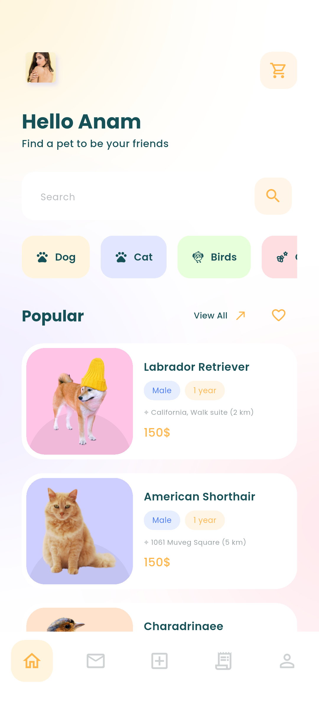
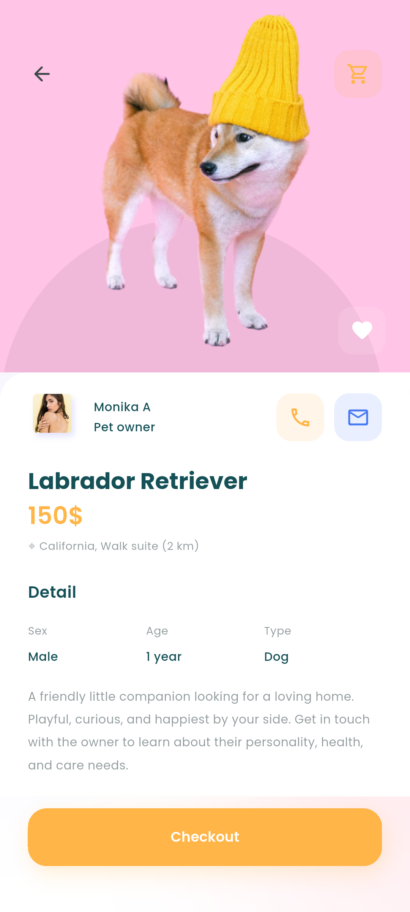
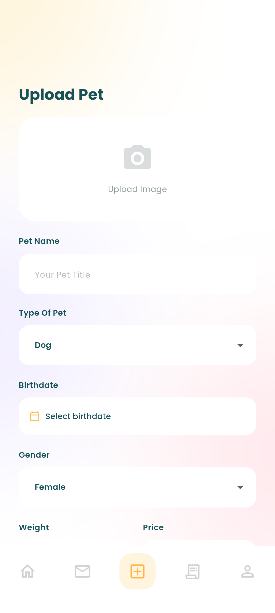
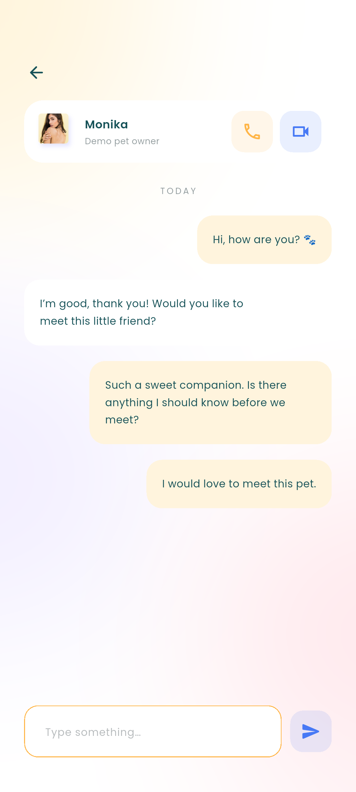
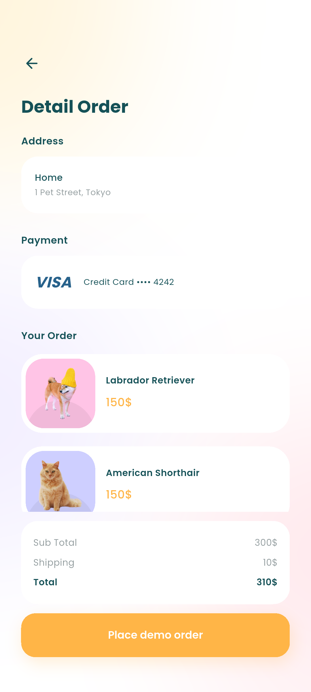
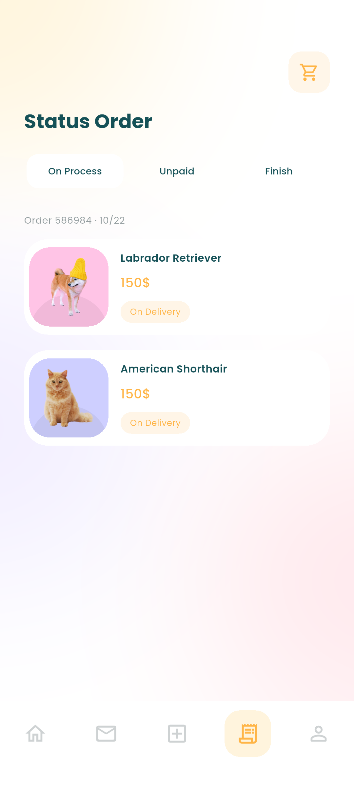
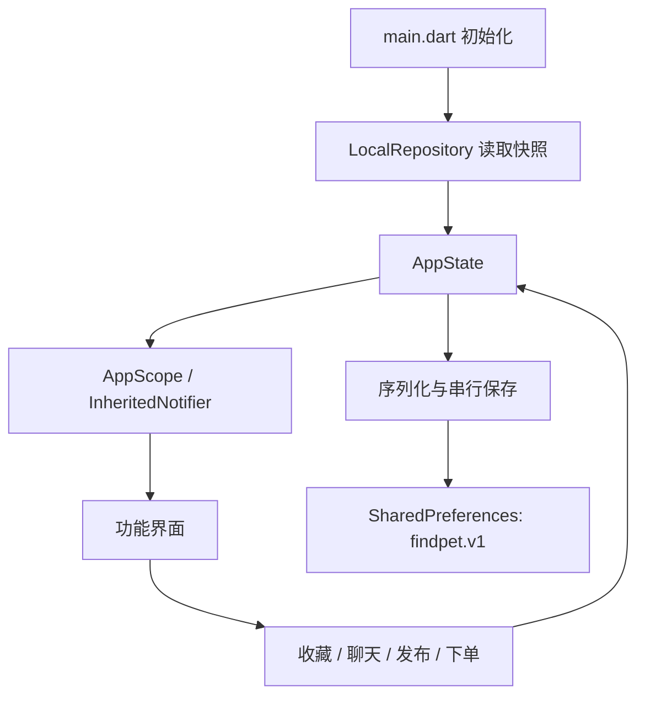

# Findpet Flutter App 项目说明

Findpet 根据 Pixso 文件 **RAW_Findpet / Wareframe** 开发，覆盖 26 个参考画板，包含引导、登录、宠物浏览、聊天、发布与下单流程。页面由真实 Flutter 控件组成，不是将整张设计稿铺在屏幕上。

## 1. 设计与交付

原稿尺寸为 414 × 896。实现保留奶油色与浅粉色背景、青绿色文字、橙色按钮、圆角白色卡片及宠物剪影；英文界面延续参考稿，修正部分拼写及与宠物类型不一致的文案。欢迎页增加操作入口，发布页补全可滚动表单。

| 内容 | 位置 |
| --- | --- |
| Flutter 源码 | `lib/` |
| 原始设计画板 | `docs/design-reference/`，26 张 Pixso 导出图 |
| App 运行截图 | `docs/screenshots/`，与原稿分开存放 |
| 全部界面对应关系 | [截图索引](截图索引.md) |
| 测试与验证结果 | [验证记录](验证记录.md) |
| Android 演示安装包 | `dist/Findpet-1.0.0-demo.apk` |

## 2. 主要界面预览

以下均为 **Flutter App 的实际运行截图**，不是 Pixso 设计稿。

| 首页：分类、搜索与宠物列表 | 详情：信息、收藏和联系 |
| --- | --- |
|  |  |

首页可切换宠物分类、搜索名称或类别、查看收藏。探索页进一步提供价格范围、地点、关键词和性别筛选，以及价格/距离排序。详情页可收藏、进入聊天或将宠物加入购物车。

| 宠物发布 | 本地聊天 |
| --- | --- |
|  |  |

发布流程包含参考稿的 Explorer 和 Album 页面，可使用内置宠物素材，也可通过系统相册/相机选择图片。表单校验成功后，新宠物加入首页。聊天支持分会话保存发送内容。

| 下单确认 | 订单列表 |
| --- | --- |
|  |  |

购物车 → 地址 → 支付方式 → 订单确认 → 成功 → 订单列表组成完整的本地演示流程。订单保存提交时的宠物、地址、支付显示信息及价格快照。

## 3. 功能范围

| 模块 | 实现内容 |
| --- | --- |
| 欢迎与引导 | 欢迎页、3 页引导、跳过、完成状态保存 |
| 登录注册 | 邮箱格式、密码长度、注册条款校验；演示登录与退出；找回密码反馈 |
| 首页与探索 | 分类、搜索、组合筛选、排序、收藏和空结果状态 |
| 宠物详情 | 原稿图片、基本信息、收藏、聊天入口、加入购物车 |
| 聊天 | 会话列表、文本发送、分会话保存、滚动到新消息 |
| 发布 | 样例/系统图片、生日选择、必填与数值校验、发布到本地目录 |
| 购物车 | 重复去重、删除、实时合计、空购物车状态 |
| 地址与支付 | 选择、新增、校验、保存最近选择 |
| 订单 | 提交后清空购物车、成功反馈、状态分组、历史详情 |
| 个人资料 | 编辑姓名和简介、查看收藏、退出演示登录 |

### 演示边界

项目是 **本地交互演示**，尚无服务端。格式正确的邮箱与至少 6 位密码即可演示登录，也可以点击 `Try the demo`。不进行真实身份认证，不保存密码，不发送密码邮件。电话和视频入口会提示服务未连接。

聊天内容只保存在本机，不会送达他人。样例文件夹用于选择内置素材，不是系统文件管理器；`Choose from device` 调用系统相册。相机/相册取消或失败会保留原表单。真实设备照片需要系统授予相应权限。

支付只用于样例流程，不扣款。卡号进行长度和 Luhn 校验，日期/CVV 有格式校验；只保存姓名、方式名称和后四位，不保存完整卡号、有效期和 CVV。请使用示例信息。新订单处于 `On Process`，未接入支付、物流、地图或服务端状态推进；其他订单状态显示空态。

收藏、购物车、个人资料、会话、发布内容、地址、支付显示信息和订单会保存在设备上。它们属于同一演示空间，没有多用户隔离或跨设备同步。清除应用数据会清空记录。

## 4. 项目结构

```text
Findpet/
├── lib/
│   ├── main.dart                    # 启动、系统栏和数据初始化
│   ├── app.dart                     # 应用入口、登录门控、五个底部导航
│   ├── core/
│   │   ├── app_state.dart           # 共享状态与业务操作
│   │   ├── theme.dart               # 颜色、字体、按钮、表单主题
│   │   └── widgets.dart             # 页面壳、卡片、输入框、空态
│   ├── data/
│   │   ├── models.dart              # Pet / Address / PaymentMethod / PetOrder
│   │   └── local_repository.dart    # 版本化 JSON 快照、串行保存
│   └── features/
│       ├── auth/auth_screens.dart
│       ├── catalog/catalog_screens.dart
│       ├── messages/message_screens.dart
│       ├── publishing/upload_screens.dart
│       ├── checkout/checkout_screens.dart
│       ├── checkout/order_screen.dart
│       └── profile/profile_screen.dart
├── assets/
│   ├── images/                      # 原稿的局部图片与品牌素材
│   └── fonts/                       # Poppins 与 OFL 授权文件
├── android/                         # Android 工程和品牌图标
├── ios/                             # iOS 工程和照片权限说明
├── web/                             # Flutter Web 入口
├── test/                            # 4 项业务状态测试
├── integration_test/app_test.dart   # 完整流程与截图采集
├── integration_test/responsive_tests.dart # 2 项小屏界面测试
├── test_driver/integration_test.dart # 运行截图写入文档目录
├── docs/
│   ├── 项目说明.md
│   ├── 截图索引.md
│   ├── 验证记录.md
│   ├── design-reference/
│   └── screenshots/
├── dist/                            # 演示 APK
├── pubspec.yaml
└── pubspec.lock
```

## 5. 架构与数据流

使用 **界面 → 应用状态 → 本地仓库** 三层结构。状态更新依靠 Flutter 自带的 `ChangeNotifier` / `InheritedNotifier`，路由使用 `Navigator`，避免为该规模项目引入额外业务框架。



- **界面层**：按业务功能组织页面。表单、筛选和标签选择使用局部状态；文本和滚动控制器及时释放。
- **状态层**：`AppState` 统一处理收藏、购物车合计、发布和订单快照；`AppScope` 负责通知依赖页面刷新。
- **数据层**：模型负责 JSON 转换。仓库维护一个版本化快照，连续保存按顺序执行，避免旧数据覆盖新数据。非法 JSON 回退到初始内容，结构错误也不会让启动崩溃。
- **导航**：一级页面由 `IndexedStack` 保留状态，二级页面推入导航栈。下单完成返回首页时清理中间页面。
- **图片**：原稿图片作为 assets 使用；用户图片压缩后以 Base64 保存在演示快照。正式产品应改为文件缓存及服务端对象存储。

| 模型 | 责任 |
| --- | --- |
| `Pet` | ID、类别、图片、价格、性别、年龄、位置和描述 |
| `Address` | 地址名称、城市和详细地址 |
| `PaymentMethod` | 显示名称、持卡人、卡号后四位 |
| `PetOrder` | 订单 ID、宠物/地址快照、支付描述、时间、状态；总价为宠物合计加 10 美元演示运费 |

### 代码精简

运行时仅增加 `shared_preferences` 和 `image_picker` 两个插件。颜色、字段、按钮、卡片和页面框架集中复用；没有网络图片库、状态管理库或额外路由框架。模板计数器及其测试已移除。截图采集只存在于集成测试，不在正式 App 中设置截图专用页面或开关。

## 6. 运行与构建

本次使用 Flutter **3.47.7 stable** / Dart **3.13.5**，依赖版本记录在 `pubspec.lock`。

```powershell
flutter pub get
flutter devices
flutter run -d <设备ID>
```

Android 构建：

```powershell
flutter build apk --release
```

当前 release 使用开发调试签名，便于安装演示，不是商店发布包。正式发布前需配置独立签名、产品包名，并接入服务端。iOS 工程已配置照片/相机用途说明；本次在 Windows 上未执行 Xcode 构建，未声明 iOS 运行验证。Web 工程可使用 `flutter run -d chrome`，相机能力受浏览器限制。

## 7. 测试与截图复现

```powershell
flutter analyze
flutter test
flutter drive --driver=test_driver/integration_test.dart --target=integration_test/app_test.dart -d <Android模拟器ID>
```

本地桌面测试运行 4 项业务逻辑测试；两项小屏界面测试随完整流程在 Android 模拟器中执行，见 `integration_test/responsive_tests.dart`。

集成测试会清除该 App 的本地演示快照，应使用专用测试设备。流程包含引导、注册校验、搜索筛选、收藏、双宠物购物车、新增地址/样例支付、下单、聊天、发布和数据恢复，截图写入 `docs/screenshots/`。具体结果见 [验证记录](验证记录.md)。

正常运行不会重置数据。重看首次引导可通过系统设置清除 Findpet 应用数据，或卸载重装。

## 8. 素材来源

UI、Logo 与宠物照片来自用户提供的 Pixso 文件。原始画板及编号保留在截图索引，仅用于本项目复现，未额外声明商业授权。柔和背景图片依据原稿颜色生成，避免运行时反复计算模糊。Poppins 来自 Google Fonts，SIL Open Font License 授权文本在 `assets/fonts/OFL.txt`。
